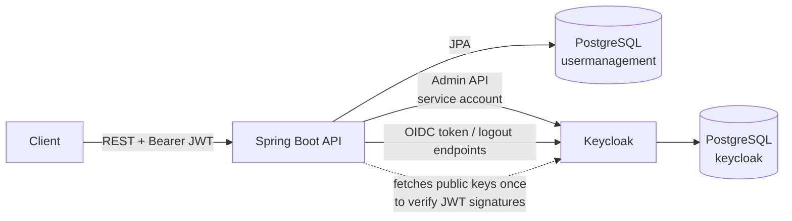
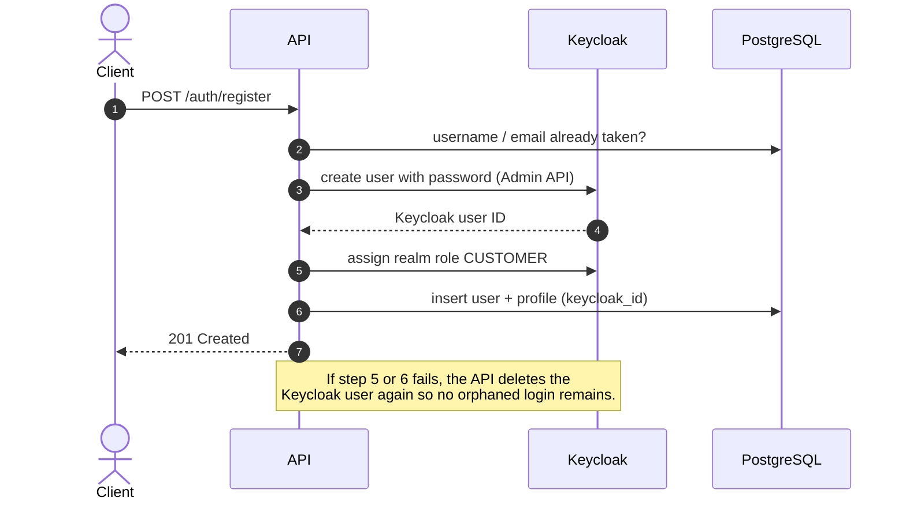

# User Management API

A Spring Boot REST API for user registration, authentication, profile management, and role-based administration. Authentication is delegated to **Keycloak**: the API never stores or checks passwords. It forwards credentials to Keycloak, validates the JWTs Keycloak issues, and keeps business data (profiles, roles, status) in PostgreSQL.


## Features

- Registration, login, token refresh, and logout backed by Keycloak (OpenID Connect)
- Stateless JWT authentication with role-based access control (`ADMIN`, `CUSTOMER`, `MERCHANT`)
- Self-service profile: view, update, and delete your own account
- Admin API: paginated user list, activate/deactivate, change role, delete
- Keycloak and the database are kept consistent (see [Design decisions](#design-decisions))
- First admin created automatically on startup
- Schema managed by Flyway; errors returned as RFC 9457 problem details
- Integration tests against a real PostgreSQL via Testcontainers
- One-command local setup: Keycloak realm, roles, and clients are imported automatically

## Architecture



**Who owns what**

| Data | Owner | Why |
|---|---|---|
| Password, enabled flag, realm roles | Keycloak | Credentials never touch the API |
| Profile (name, phone, address), status, role copy | PostgreSQL | Business data the API queries and paginates |
| Link between the two | `users.keycloak_id` | Equals the `sub` claim in every access token |

Keycloak uses two clients in the `user-management` realm:

| Client | Grant | Used for |
|---|---|---|
| `user-management-api` | `password`, `refresh_token` | Logging users in, refreshing tokens, logging out |
| `user-management-admin` | `client_credentials` (service account) | Creating, updating, disabling, and deleting users |

## How it works

### Registration



### Login and calling a protected endpoint

```mermaid
sequenceDiagram
    autonumber
    actor U as Client
    participant A as API
    participant K as Keycloak
    participant D as PostgreSQL
    U->>A: POST /auth/login {username, password}
    A->>K: token endpoint (password grant)
    K-->>A: access_token (5 min) + refresh_token
    A-->>U: tokens
    U->>A: GET /profiles/me (Authorization: Bearer access_token)
    A->>A: verify signature, expiry, issuer; map realm_access.roles to ROLE_*
    A->>D: find user by keycloak_id = token "sub"
    A-->>U: 200 profile
```

## API

All endpoints accept and return JSON. Interactive docs: **Swagger UI** at `http://localhost:8080/swagger-ui.html` (use **Authorize** with an access token).

| Method | Path | Access | Description |
|---|---|---|---|
| `POST` | `/auth/register` | Public | Create an account with the `CUSTOMER` role |
| `POST` | `/auth/login` | Public | Exchange username and password for tokens |
| `POST` | `/auth/refresh` | Public | New access token from a refresh token |
| `POST` | `/auth/logout` | Public | End the session behind a refresh token |
| `GET` | `/profiles/me` | Authenticated | Current user's profile |
| `PUT` | `/profiles/me` | Authenticated | Update name, phone, address (name is synced to Keycloak) |
| `DELETE` | `/profiles/me` | Authenticated | Delete own account |
| `GET` | `/admin/users?page=&size=&sort=` | `ADMIN` | Paginated user list. Sortable by `createdAt`, `username`, `email`, `role`, `status` |
| `GET` | `/admin/users/{id}` | `ADMIN` | User by ID |
| `PUT` | `/admin/users/{id}/status` | `ADMIN` | `ACTIVE` / `INACTIVE` (inactive users cannot log in) |
| `PUT` | `/admin/users/{id}/role` | `ADMIN` | Change role |
| `DELETE` | `/admin/users/{id}` | `ADMIN` | Delete a user |

Errors use the [problem details](https://www.rfc-editor.org/rfc/rfc9457) format:

```json
{
  "status": 400,
  "detail": "Request validation failed",
  "errors": { "email": "must be a well-formed email address" }
}
```

| Status | When |
|---|---|
| 400 | Invalid input or unsupported sort field |
| 401 | Missing/invalid access token, wrong credentials, invalid refresh token |
| 403 | Authenticated but missing the required role |
| 404 | User not found |
| 409 | Username/email taken, or an admin modifying their own account |
| 502 | Keycloak unavailable or returned an unexpected error |

## Getting started

**Requirements:** Java 17+ and Docker.

```bash
# 1. Start PostgreSQL and Keycloak (the realm is imported automatically, ~30 s)
docker compose up -d

# 2. Run the API on http://localhost:8080
./mvnw spring-boot:run
```

On first start the API creates a bootstrap admin: **`admin` / `admin12345`**. You can run step 2 right after step 1: the API waits (up to 90 s) for Keycloak to finish starting.

### Try it

```bash
# Register and log in
curl -X POST localhost:8080/auth/register -H 'Content-Type: application/json' \
  -d '{"username":"alice","email":"alice@example.com","password":"password123","firstName":"Alice","lastName":"Doe"}'

TOKEN=$(curl -s -X POST localhost:8080/auth/login -H 'Content-Type: application/json' \
  -d '{"username":"alice","password":"password123"}' | jq -r .access_token)

curl localhost:8080/profiles/me -H "Authorization: Bearer $TOKEN"
```

Keycloak admin console: `http://localhost:8081` (`admin` / `admin`).

### Tests

```bash
./mvnw test   # Docker must be running (Testcontainers starts PostgreSQL)
```

The integration tests run the full HTTP stack against a real PostgreSQL. The two Keycloak clients are mocked, which keeps the suite fast and lets it simulate Keycloak failures.

### Configuration

Defaults in `application.yml` match `docker-compose.yml`. They are **for local development only**; override them with environment variables elsewhere.

| Variable | Default |
|---|---|
| `DB_URL` / `DB_USERNAME` / `DB_PASSWORD` | `jdbc:postgresql://localhost:5433/usermanagement` / `usermanagement` / `usermanagement` |
| `KEYCLOAK_URL` / `KEYCLOAK_REALM` | `http://localhost:8081` / `user-management` |
| `KEYCLOAK_ADMIN_CLIENT_SECRET` / `KEYCLOAK_LOGIN_CLIENT_SECRET` | dev secrets from `docker/keycloak/realm-user-management.json` |
| `BOOTSTRAP_ADMIN_ENABLED` / `_USERNAME` / `_EMAIL` / `_PASSWORD` | `true` / `admin` / `admin@example.com` / `admin12345` |

### Troubleshooting

| Symptom | Fix |
|---|---|
| `Java 17 or newer is required` | Maven uses the JDK in `JAVA_HOME`, which can differ from `java` on your `PATH`. Check with `./mvnw -v`, then point `JAVA_HOME` to JDK 17+ (SDKMAN: `sdk use java <17+ version>`). |
| `Keycloak did not become available within 90s` | Keycloak is not running. Start it with `docker compose up -d` and check `docker compose logs keycloak`. |
| `Could not find a valid Docker environment` when running tests | Start Docker. Testcontainers needs a running Docker daemon. |
| Login fails after changing `realm-user-management.json` | The realm is imported only once. Re-import it with `docker compose down -v && docker compose up -d` (this also clears local data). |

## Design decisions

- **Keycloak is not part of the database transaction.** Writes therefore follow one rule: change the database and flush, then call Keycloak last. If Keycloak fails, the exception rolls the database back. Registration is the exception, because the Keycloak user must exist first to obtain its ID. It compensates by deleting that Keycloak user if any later step fails.
- **Separate databases.** Keycloak's ~90 tables live in their own `keycloak` database, so Flyway fully owns the application schema (`ddl-auto: validate`).
- **Keycloak access is isolated** in `KeycloakUserClient` (Admin API) and `KeycloakTokenClient` (OIDC endpoints). Services stay readable and tests mock just these two classes.
- **Usernames and emails are lower-cased**, matching how Keycloak stores them, so `Alice` and `alice` cannot both register.
- **Sorting is whitelisted**, because the sort is appended to a custom JPQL query with a `JOIN FETCH` that avoids N+1 queries.
- **Admins cannot change their own role or status, or delete themselves**, so the last admin cannot lock everyone out.

## Known limitations

- **Access tokens stay valid until they expire (5 minutes).** Logout, deactivation, and role changes take effect at the next login or refresh, not instantly. Instant revocation would need token introspection on every request.
- **The password grant** (direct username/password exchange) keeps the API simple for non-browser clients. OAuth 2.1 recommends the authorization code flow with PKCE for browser apps instead.
- **Registration compensation is best-effort.** If deleting the orphaned Keycloak user also fails, it is logged for manual clean-up rather than retried.
- No email verification or password reset flow. Both would be enabled in Keycloak rather than built into the API.

## Project structure

```text
src/main/java/com/adisputraa/usermanagement
├── bootstrap/    # creates the first ADMIN on startup
├── config/       # security, Keycloak beans, typed properties
├── controller/   # REST endpoints
├── dto/          # request/response records with validation
├── entity/       # JPA entities (User, UserProfile)
├── handler/      # exception → problem details
├── keycloak/     # KeycloakUserClient (Admin API), KeycloakTokenClient (OIDC)
├── mapper/       # entity → DTO
├── repository/   # Spring Data JPA
└── service/      # business logic and Keycloak/DB consistency
docker/
├── keycloak/realm-user-management.json   # realm, roles, clients (dev secrets)
└── postgres/init/                         # creates the keycloak database
```
